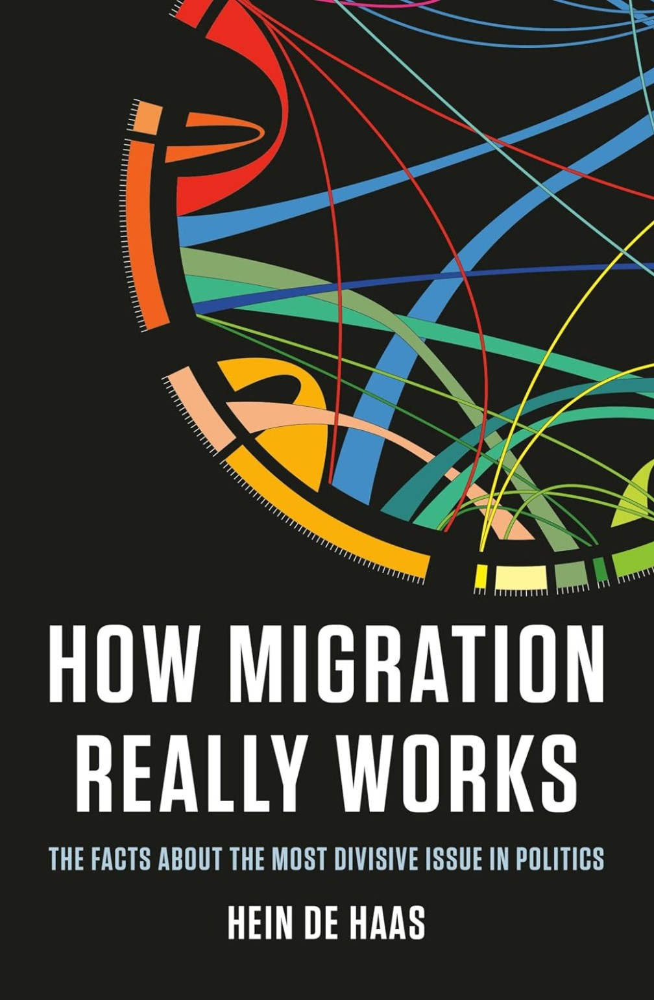

> [!note]- Bronnen
> - [Officiële website — heindehaas.org](https://heindehaas.org/)
> - [Penguin — boekpagina](https://www.penguin.com.au/books/how-migration-really-works-9780241632215)
> - [Penguin — inkijkexemplaar (inleiding + hoofdstuk 1, PDF)](https://cdn.penguin.co.uk/dam-assets/books/9780241998779/9780241998779-sample.pdf)
> - [The Guardian — recensie door Daniel Trilling, "Home truths" (nov. 2023)](https://www.theguardian.com/books/2023/nov/03/how-migration-really-works-by-hein-de-haas-review-home-truths)
> - [Publishers Weekly — recensie](https://www.publishersweekly.com/9781541604315)
> - [Population and Development Review — academische recensie (Van Hook, 2024)](https://onlinelibrary.wiley.com/doi/full/10.1111/padr.12664)
> - [New South Institute — recensie door Alan Hirsch](https://nsi.org.za/publications/dissecting-migration-myths-hein-de-haas-alan-hirsch/)
> - [Kiel Institute — kritische heranalyse van de "migration hump" (Benček & Schneiderheinze)](https://ifw-kiel.de/publications/higher-economic-growth-in-poor-countries-lower-migration-flows-to-the-oecd-revisiting-the-migration-hump-with-panel-data-31453)
> - [Goodreads — lezersinformatie](https://www.goodreads.com/book/show/82005192-how-migration-really-works)

## Core idea

Bijna alles wat in het publieke debat over migratie als vaststaand feit wordt gepresenteerd — door zowel voor- als tegenstanders — is feitelijk onjuist. Migratie staat niet op een historisch hoogtepunt, grensbeleid vermindert migratie niet maar vergroot ze vaak, en ontwikkelingshulp in arme landen leidt niet tot minder maar juist (eerst) tot meer emigratie. De Haas' kernstelling: migratiebeleid faalt systematisch omdat het gebaseerd is op mythes die politici — links en rechts — bewust in stand houden, niet omdat ze de feiten niet kennen, maar omdat de feiten ongemakkelijk zijn.

## Key concepts

[[migration-hump]], [[receiving-country-bias]], [[pro-anti-framing]], [[self-fulfilling-prophecy]], [[nocebo-effect]], [[leverage-points]], [[prediction-as-power]]

## What I took from it

### General

> *Samenvatting gebaseerd op externe bronnen (inleiding en hoofdstuk 1 volledig geraadpleegd, overige hoofdstukken via recensies en auteursmateriaal) — boek niet persoonlijk gelezen.*

De Haas schreef dit boek na drie decennia migratieonderzoek aan Oxford en Amsterdam, gefrustreerd door hoe migratiedebatten structureel verzanden in een zinloze pro/anti-tegenstelling. Zijn analogie is scherp: niemand vraagt een econoom of hij "voor of tegen de economie" is, of een geograaf of ze "voor of tegen verstedelijking" is — maar migratie wordt wél zo bediscussieerd, met als gevolg dat de echte vraag (welk beleid werkt, welk beleid faalt, en waarom) nooit gesteld wordt.

### Connection to our work

**De pro/anti-framing-val is het AI-debat in een andere jas.** De Haas' observatie dat migratie onmogelijk zinnig te bespreken is in pro/anti-termen — omdat het geen standpunt is maar een intrinsiek onderdeel van bredere sociale en economische verandering — is letterlijk toepasbar op hoe organisaties over AI praten. "Zijn we voor of tegen AI?" is even leeg als "zijn we voor of tegen migratie?" Het dwingt een vraag over systeemontwerp (hoe benutten we dit, hoe beperken we de schade) in een morele tegenstelling die geen beleid oplevert. Zie [[pro-anti-framing]].

**Dwangbeleid dat het probleem verergert dat het claimt op te lossen.** De centrale empirische vondst van het boek — grensverharding verandert circulaire arbeidsmigratie in permanente vestiging, omdat mensen die weten dat teruggaan en later weer terugkomen niet meer kan, blijven — is een exacte herhaling van het nocebo-patroon uit [De meeste mensen deugen](bregman-de-meeste-mensen-deugen-een-nieuwe-geschiedenis-van-de-mens.md): een systeem gebouwd op wantrouwen en controle produceert het gedrag dat het probeert te voorkomen. In AI-first organisaties is dit hetzelfde mechanisme bij surveillance-achtige productiviteitstools: hoe strakker de controle, hoe meer de mensen zich permanent indekken (gaming, schaduwsystemen) in plaats van zich flexibel aan te passen.

**Het "migration hump" als waarschuwing tegen lineaire interventielogica.** De Haas' meest contra-intuïtieve bevinding: ontwikkeling in arme landen leidt niet tot minder maar aanvankelijk tot *meer* emigratie — omdat mensen eerst de middelen en aspiraties nodig hebben om te kunnen vertrekken. Dit is een waarschuwing tegen elke organisatorische interventie die veronderstelt dat een verbetering (meer budget, meer capaciteit, meer AI-vaardigheid) monotoon tot minder van het ongewenste gedrag leidt. Soms maakt het eerst meer mogelijk, inclusief exit. Zie [[migration-hump]].

**Receiving-country bias als blinde vlek in value-flow-denken.** De Haas toont dat decennia aan migratieonderzoek en -beleid eenzijdig kijken naar het effect op bestemmingslanden, en het effect op oorsprongslanden (remittances, brain drain, lokale arbeidsmarkten) grotendeels negeren — met als gevolg een fundamenteel onvolledig beeld. Dit is exact de fout die een AI-waardeketen-analyse maakt als ze alleen het eindpunt (de gebruiker, de klant) meet en de herkomst van de waarde (data-arbeid, contentmoderatoren, de upstream mensen die het systeem "voeden") buiten beeld laat. Zie [[receiving-country-bias]].

Related: [De meeste mensen deugen: Een nieuwe geschiedenis van de mens](bregman-de-meeste-mensen-deugen-een-nieuwe-geschiedenis-van-de-mens.md), [Prophecy: Prediction, Power, and the Fight for the Future, from Ancient Oracles to AI](veliz-prophecy-prediction-power-and-the-fight-for-the-future.md), [Thinking In Systems: A Primer](meadows-thinking-in-systems-a-primer.md), [Weapons of Math Destruction: How Big Data Increases Inequality and Threatens Democracy](oneil-weapons-of-math-destruction.md)

---

## Samenvatting

### Centrale stelling

> *"Deze politici hebben niet alleen gefaald hun langdurige en eindeloos herhaalde beloftes na te komen — hun beleid heeft de zaken in veel opzichten erger gemaakt."*

*Wat dit betekent:* migratiebeleid faalt niet per ongeluk. De Haas' these is dat westerse regeringen sinds het einde van de Koude Oorlog een "Oorlog tegen Immigratie" voeren die systematisch averechts werkt — niet omdat de uitvoering tekortschiet, maar omdat het beleid gebaseerd is op een reeks mythes die politici van links tot rechts, belangengroepen, en internationale organisaties (IOM, UNHCR) allemaal — uit eigen belang — in stand houden.

Het boek is opgebouwd in drie delen, elk met een eigen reeks mythes:

| Deel | Focus | Mythes |
|---|---|---|
| I. Myths of Migration | Omvang en oorzaken van migratie | 1–7 |
| II. Immigration: Threat or Solution? | Effecten op bestemmings- en oorsprongslanden | 8–15 |
| III. Migration Propaganda | Hoe politiek en media de mythes in stand houden | 16–22 |

---

### De 22 mythes

| # | Mythe | Deel |
|---|---|---|
| 1 | Migratie staat op een historisch hoogtepunt | I |
| 2 | Grenzen zijn oncontroleerbaar | I |
| 3 | De wereld kampt met een vluchtelingencrisis | I |
| 4 | Onze samenlevingen zijn diverser dan ooit | I |
| 5 | Ontwikkeling in arme landen zal migratie verminderen | I |
| 6 | Emigratie is een wanhopige vlucht uit ellende | I |
| 7 | We hebben geen arbeidsmigranten nodig | I |
| 8 | Immigranten stelen banen en drukken lonen | II |
| 9 | Immigratie ondermijnt de verzorgingsstaat | II |
| 10 | Integratie van immigranten is mislukt | II |
| 11 | Massamigratie heeft massale segregatie veroorzaakt | II |
| 12 | Immigratie doet de criminaliteit stijgen | II |
| 13 | Emigratie leidt tot brain drain | II |
| 14 | Immigratie tilt alle boten | II |
| 15 | We hebben immigranten nodig om vergrijzing op te lossen | II |
| 16 | Grenzen gaan dicht | III |
| 17 | Conservatieven zijn strenger op immigratie | III |
| 18 | De publieke opinie is tegen immigratie gekeerd | III |
| 19 | Smuggling is de oorzaak van illegale migratie | III |
| 20 | Mensenhandel is een vorm van moderne slavernij | III |
| 21 | Grensrestricties verminderen immigratie | III |
| 22 | Klimaatverandering zal tot massamigratie leiden | III |

Elk hoofdstuk volgt dezelfde opbouw: eerst de mythe en haar politieke oorsprong, dan "How it really works" — de empirische weerlegging op basis van historisch, antropologisch, demografisch en economisch bewijs.

---

### 1. Migratie is niet op een historisch hoogtepunt

De Haas' meest fundamentele cijfer: internationale migranten vormen al decennia stabiel ongeveer 3% van de wereldbevolking — in 1960 zo'n 92 miljoen mensen, in 2000 170 miljoen, in 2017 258 miljoen. De absolute aantallen stijgen, maar evenredig met de wereldbevolking. Migratie was zelfs hoger tijdens de transatlantische migratiegolf van eind 19e/begin 20e eeuw: tussen 1846 en 1924 vertrok zo'n 19% van de Britse bevolking, 30% van de Italiaanse.

**Wat wél veranderd is: de richting, niet de omvang.** Europa transformeerde van de grootste bron van kolonisten en migranten naar wereld ter wereld (vóór WO II) naar een belangrijke bestemming (na WO II), doordat snelle economische groei, verzorgingsstaten en dalende geboortecijfers de eigen emigratie deden opdrogen terwijl arbeidstekorten postkoloniale en "gastarbeider"-migratie aantrokken. Wat aanvoelt als "ongekende" immigratie is vanuit een Eurocentrisch perspectief vooral een omkering van de geografische herkomst — niet van de schaal.

**Interne migratie wordt systematisch onderschat.** Zo'n 60% van alle migranten wereldwijd verhuist binnen de eigen landsgrenzen (ongeveer 760 miljoen mensen) — plattelandsvlucht naar steden, met name in snel urbaniserende landen. Internationale migratie krijgt alle politieke aandacht; interne migratie, veruit de grootste stroom, krijgt nauwelijks aandacht.

---

### 2. De paradox van grensbeleid: restricties produceren méér blijvende migratie

Het kernargument van mythe 21 (uitgewerkt al in de inleiding): grensverharding vermindert migratie niet — ze verandert *circulaire* migratie in *permanente vestiging*.

**Het mechanisme:** zolang grenzen relatief open zijn, pendelen arbeidsmigranten heen en weer tussen herkomst- en bestemmingsland — ze komen voor werk, gaan terug, komen weer. Zodra grenzen verharden, verandert de rekening: wie weet dat teruggaan betekent dat je er niet meer in komt, blijft. Gezinshereniging volgt, en circulaire migratie slaat om in permanente vestiging.

**Concrete gevallen:**
- **VS–Mexico**: massale investeringen in grensbewaking sinds eind jaren '70 veranderden een grotendeels circulaire stroom Mexicaanse arbeiders (heen en weer naar Californië en Texas) in een 11-miljoen-sterke, permanent gevestigde bevolking over de hele VS. De ongedocumenteerde bevolking groeide van 3,5 naar 11 miljoen — ondanks (of dankzij) grensbewaking en deportaties.
- **Europa–Turkije/Noord-Afrika**: groeiende grensrestricties in de jaren '70–'80 duwden Turkse en Noord-Afrikaanse "gastarbeiders" naar permanente vestiging door terugkeer te ontmoedigen en gezinsmigratie aan te moedigen.
- **VK–Brexit**: in plaats van Oost-Europese arbeiders te stimuleren terug te gaan, versterkte Brexit juist hun vastberadenheid om permanent te blijven — met immigratie naar het VK die paradoxaal een historisch hoogtepunt bereikte in de post-Brexit jaren.

---

### 3. Ontwikkeling vermindert migratie niet — ze maakt ze eerst mogelijk ("migration hump")

Een van De Haas' bekendste eigen onderzoeksbevindingen (mythe 5), al uitgewerkt in zijn academisch werk vóór dit boek: het idee dat ontwikkelingshulp in arme landen migratiedruk zal verminderen is een hardnekkig beleidsgeloof — maar het klopt niet.

**De "migration hump":** economische ontwikkeling in een arm land vergroot aanvankelijk de emigratie, voordat ze — op een veel hoger inkomensniveau dan de meeste beleidsmakers veronderstellen — weer afneemt. Mechanisme: migreren kost geld, informatie, netwerken en aspiraties. Wie in extreme armoede leeft, heeft die middelen niet en migreert vaak helemaal niet (of alleen intern, over korte afstand). Ontwikkeling vergroot precies die capaciteiten — onderwijs, mediatoegang, spaargeld — en dus de mogelijkheid om te migreren, lang voordat ze de *noodzaak* om te migreren wegneemt.

**Kritische kanttekening — niet onomstreden:** onderzoekers van het Kiel Institute (Benček & Schneiderheinze) betwisten de hump op methodologische gronden: hun tijdreeksanalyse (in plaats van de gangbare cross-sectionele vergelijking tussen landen) vindt dat wanneer het inkomen van een land stijgt, de emigratie naar OESO-landen juist daalt — ook vanuit zeer arme startpunten, zij het met een klein effect. Dit wijst erop dat de hump deels een artefact van de onderzoeksmethode kan zijn, niet een universele wet. De Haas' bredere punt — dat "meer ontwikkelingshulp = minder migratie" een slecht onderbouwde beleidsaanname is — staat overigens los van wie hier gelijk heeft: zelfs de kritische heranalyse bevestigt dat het effect van inkomensgroei op migratie klein en onzeker is, niet de krachtige hefboom die beleidsmakers veronderstellen.

---

### 4. Emigratie is geen wanhoopsvlucht — het vereist middelen en aspiraties

Mythe 6 bouwt direct op de hump voort: het beeld van migranten als mensen die, gedreven door pure ellende, "niets te verliezen hebben", klopt empirisch niet. De allerarmsten migreren het minst — vaak omdat ze de middelen niet hebben om te vertrekken, en als ze dat wel doen, gebeurt dat doorgaans over korte afstand (regionaal, intern), niet transcontinentaal.

**Het aspiraties-capaciteiten-kader:** migratie vereist zowel de wens om te vertrekken (aspiratie) als de middelen om dat te doen (capaciteit: geld, documenten, netwerken, informatie). Pure armoede zonder capaciteit produceert geen migratie — ze produceert immobiliteit. Dit draait het populaire beeld van "push-factoren" (armoede duwt mensen weg) om: migratie is typisch een strategie van mensen met *enige* middelen, niet van de allerarmsten.

---

### 5. Immigranten "stelen" geen banen en ondermijnen de verzorgingsstaat niet

Mythes 8 en 9: het economisch effect van immigratie op lonen en werkgelegenheid van de autochtone bevolking is volgens het overgrote deel van het economisch onderzoek verwaarloosbaar klein — immigranten vullen doorgaans sectoren (zorg, landbouw, horeca) waar structurele tekorten bestaan, eerder dan dat ze rechtstreeks concurreren met binnenlandse werknemers. Op de verzorgingsstaat: onderzoek laat zien dat mensen zelden migreren om uitkeringen te incasseren, dat de fiscale kosten van immigratie klein zijn ten opzichte van het BNP, en dat ook ongedocumenteerde migranten via belastingen (loon-, btw- en accijnsbelasting) netto bijdragen aan het systeem waarvan ze zelf vaak geen aanspraak op kunnen maken.

---

### 6. Smuggling versus trafficking — een cruciaal en voortdurend verward onderscheid

De Haas besteedt zijn "Reader's Note" (en de mythes 19–20) aan een terminologische verduidelijking die zelden gemaakt wordt in media en politiek:

- **Smuggling** is dienstverlening: migranten (inclusief vluchtelingen) betalen vrijwillig een tussenpersoon om een grens over te steken zonder toestemming. Het is een markt die ontstaat *omdat* grenzen gesloten zijn — geen oorzaak van illegale migratie maar een gevolg van de restricties die illegale migratie zelf creëren (mythe 19).
- **Trafficking (mensenhandel)** is iets fundamenteel anders: structurele uitbuiting van werknemers door misleiding en dwang. Veel gevallen van mensenhandel impliceren geen grensoverschrijding, en waar wel, gebeurt de ernstigste uitbuiting vaak binnen *legale* migratie en legale arbeidscontracten (mythe 20).

Het voortdurend samenvoegen van deze twee begrippen in politiek discours — "we vechten tegen mensenhandelaars" als rechtvaardiging voor grensverharding — verhult dat de twee compleet verschillende interventies vereisen, en dat grensverharding smuggling eerder *aanwakkert* (het vergroot de prijs en het risico van de dienst) dan bestrijdt.

---

### 7. Klimaatmigratie: overschat en verkeerd gekaderd

Mythe 22: klimaatverandering zal volgens De Haas niet leiden tot massale grensoverschrijdende migratie naar het Westen. De empirie: de overgrote meerderheid van klimaatgerelateerde verplaatsing is intern (binnen het eigen land) en over korte afstand — mensen die hun huis verliezen door een overstroming trekken naar de dichtstbijzijnde stad, niet naar Europa. Climate-activisten die het vooruitzicht van "klimaatvluchtelingen naar het Westen" gebruiken om actie tegen de uitstoot te bepleiten, bouwen (volgens De Haas, zelf een pleitbezorger van klimaatactie) op een empirisch zwak fundament — net zoals rechtse partijen een vergelijkbaar doembeeld gebruiken om grenzen te verharden.

---

### 8. De pro/anti-framing-val

Een van de meest overdraagbare inzichten van het boek, buiten het domein van migratie zelf: De Haas beschrijft hoe het "show of hands"-moment tijdens een publiek debat — "wie is, met professor De Haas, voor immigratie, en wie tegen?" — hem deed beseffen wat er structureel misgaat. Vragen of je "voor of tegen migratie" bent is net zo onzinnig als een econoom vragen of hij voor of tegen de economie is, of een agronoom of hij voor of tegen landbouw is. Migratie is, zoals de economie of verstedelijking, een intrinsiek onderdeel van bredere sociale verandering — geen standpunt waarover je "voor" of "tegen" kunt zijn.

Deze framing-fout heeft reële beleidsgevolgen: ze reduceert elk beleidsgesprek tot een identiteitsstrijd tussen kampen, en maakt de technische vraag — welk beleid werkt, welk beleid faalt, en waarom — onbespreekbaar.

---

### De verklaring: waarom falend beleid blijft terugkeren

De Haas' antwoord op de vraag die zijn studenten hem steeds weer stelden — waarom blijven we beleid herhalen dat zo evident gefaald heeft? — is niet onwetendheid, maar een bewuste keuze. Politici (links én rechts), belangengroepen (vakbonden, bedrijfslobby's) en internationale organisaties (IOM, UNHCR) houden mythes in stand omdat die mythes hen dienen: ze leiden de aandacht af van de echte oorzaken van loonstagnatie, woningnood en onzekerheid, en ze rechtvaardigen begrotingen, mandaten en herverkiezing.

> De centrale claim van het boek: dit beleid is niet gedoemd om te falen ondanks goede bedoelingen — het beleid zelf hoort bij de oorzaken van de problemen die het beweert op te lossen.

---

## Correlaties met de knowledge base

### Bregman — De meeste mensen deugen

De structurele verwantschap is het grootst met Bregman: beide boeken zijn opgebouwd als een reeks mythe-ontmantelingen, en beide landen op dezelfde metabevinding — systemen gebouwd op wantrouwen (van migranten, van mensen in het algemeen) produceren het gedrag dat ze vrezen. Bregmans nocebo-effect ([[nocebo-effect]]) is letterlijk het mechanisme achter De Haas' grensparadox: grensverharding behandelt migranten als een risico dat ingedamd moet worden, en creëert daardoor precies de permanente, ongedocumenteerde populatie die ze probeerde te voorkomen.

### Véliz — Prophecy

Véliz' these dat predictie een machtsinstrument is, vermomd als neutrale kennis, herkent zich in hoe De Haas politieke "crisis"-retoriek over migratie beschrijft: UNHCR en IOM claimen herhaaldelijk "ongekende" vluchtelingenaantallen, politici "voorspellen" een onbeheersbare toestroom — en die voorspelling rechtvaardigt vervolgens het beleid (grensverharding) dat de voorspelling mede waarmaakt (permanente vestiging in plaats van circulaire migratie). Dezelfde zelfvervullende structuur, nu op politiek-maatschappelijke schaal in plaats van individueel-algoritmisch. Zie [[self-fulfilling-prophecy]], [[prediction-as-power]].

### Meadows — Thinking in Systems

De Haas' kritiek is een directe illustratie van Meadows' hefboompunten-hiërarchie ([[leverage-points]]): decennia aan migratiebeleid grijpen in op lage-impact hefbomen (grensbudgetten, aantal agenten, boetes — niveau 12–9), terwijl de werkelijke drijvende krachten — arbeidsvraag, netwerken, aspiraties-en-capaciteiten-dynamiek — op niveau 5–3 liggen (regels van het systeem, doelen van het systeem). Het "paradigma" op niveau 2 dat De Haas aanvalt: het geloof dat migratie een probleem is dat "opgelost" kan worden in plaats van een intrinsiek onderdeel van economische en demografische verandering dat bestuurd moet worden.

---

## Kritiek op De Haas

### 1. Herhalend format
Publishers Weekly noemt de opzet — 22 hoofdstukken die allemaal exact hetzelfde stramien volgen (mythe, oorsprong, weerlegging) — "somewhat repetitious", ook al blijft het informatief. De keerzijde van de consistente structuur is leesvermoeidheid over 450+ pagina's.

*Sector van de kritiek: boekrecensenten.* Zie [Publishers Weekly](https://www.publishersweekly.com/9781541604315).

### 2. Beperkte wetenschappelijke oorspronkelijkheid
De academische recensie in *Population and Development Review* (Van Hook, 2024) oordeelt dat het boek vooral bestaande onderzoekslijnen samenvat voor een breed publiek, met een relatief beperkte eigen wetenschappelijke bijdrage — de waarde zit in de synthese en toegankelijkheid, niet in nieuwe empirie. Dezelfde recensie signaleert dat het boek risico loopt te eenzijdig af te wijzen dat immigratie wezenlijke aanpassingsproblemen voor gastsamenlevingen met zich meebrengt.

*Sector van de kritiek: academische demografen.* Zie [Population and Development Review](https://onlinelibrary.wiley.com/doi/full/10.1111/padr.12664).

### 3. De "migration hump" zelf is methodologisch betwist
De kern van mythe 5 — ontwikkeling verhoogt eerst emigratie — steunt op cross-sectionele vergelijkingen tussen landen op één moment in tijd. Onderzoekers van het Kiel Institute herberekenden het verband met tijdreeksdata (hetzelfde land, over tijd) en vinden het omgekeerde: stijgend inkomen in een arm land hangt samen met *dalende* emigratie naar OESO-landen, zij het met een klein effect. Dit is geen randkritiek van buitenstaanders — het raakt de kernbevinding waarop De Haas' eigen reputatie als onderzoeker grotendeels gebouwd is.

*Sector van de kritiek: economen en migratieonderzoekers.* Zie [Kiel Institute](https://ifw-kiel.de/publications/higher-economic-growth-in-poor-countries-lower-migration-flows-to-the-oecd-revisiting-the-migration-hump-with-panel-data-31453).

### 4. Weinig ruimte voor de bezwaren die overblijven na de feiten
Meerdere recensenten (Guardian, Hirsch/NSI) prijzen de evidence-based aanpak, maar merken op dat De Haas na het slopen van de mythes weinig ruimte laat voor legitieme resterende zorgen — culturele aanpassing op lokale schaal, snelheid van verandering in specifieke buurten, of de politieke onhaalbaarheid van "geen eenvoudige oplossingen" als conclusie. Het wegnemen van foute feiten is niet hetzelfde als het wegnemen van elke reden tot zorg.

*Sector van de kritiek: beleidscommentatoren.* Zie [The Guardian](https://www.theguardian.com/books/2023/nov/03/how-migration-really-works-by-hein-de-haas-review-home-truths) en [New South Institute](https://nsi.org.za/publications/dissecting-migration-myths-hein-de-haas-alan-hirsch/).
